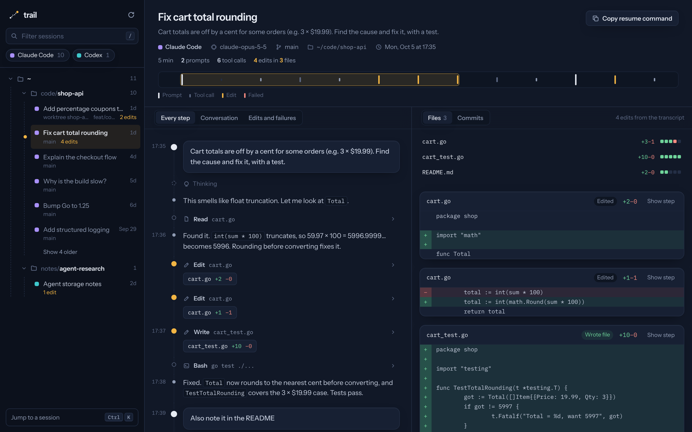

# trail

See what your coding agents did, folder by folder.



trail finds the sessions that Claude Code, Codex, OpenCode, Gemini CLI and Kiro CLI leave on your machine, files each session under the project it ran in, and shows the transcript next to the changes it made. Click an edit in the transcript to jump to its diff; click a diff to jump back to the step that made it. A Commits tab lists what landed in git while the session ran, with the commits that touch the agent's files first. Any session can be [exported](#export-a-session) as one HTML file to share, and [Lessons](#lessons) suggests rules for CLAUDE.md or AGENTS.md from what you keep correcting.

Each session opens with a trace: one tick per step, prompts tall, edits amber, failures red. Drag across it to move through the transcript. Press ⌘K (Ctrl+K) to search: it matches session names, and everything said and run inside every transcript. Pick a match to open the session at that step, with every other matching step marked on the trace; `n` and `Shift+N` step through them. `/` filters the sidebar by name, and `j`/`k` step between sessions.

It’s a single static Go binary with an embedded browser UI (fonts included, nothing loads from the network). It only reads agent storage, never writes to it, writes an export only where you save it, and makes no network calls unless you turn on [related sessions](#related-sessions-opt-in), which talk to an embedding model on your machine.

## Install

With [Homebrew](https://brew.sh) on macOS:

```
brew install veluribharath/tap/trail
trail -open
```

Or download the archive for your machine from [Releases](https://github.com/veluribharath/trail/releases/latest), unpack it, and run `./trail`. Builds are published for macOS (Apple Silicon and Intel) and Linux (x86_64 and ARM64).

```
tar -xzf trail_*_darwin_arm64.tar.gz
xattr -d com.apple.quarantine ./trail   # macOS only: the binary isn't signed
./trail -open
```

With Go 1.24 or newer:

```
go install github.com/veluribharath/trail@latest
```

From source:

```
git clone https://github.com/veluribharath/trail && cd trail
make build
```

## Run it

```
./trail            # http://127.0.0.1:7878
./trail -open      # and open the browser
./trail -list      # print sessions by folder and exit
./trail -search "flaky login"   # print matching sessions and steps, and exit
./trail -prices    # print the token prices used for costs, and exit
./trail -export c1 -o session.html   # write one session as an offline page, and exit
./trail -retro .   # print rules worth adding to CLAUDE.md or AGENTS.md for this project, and exit
```

On a remote dev box, `./trail -host 0.0.0.0` and open the port from your laptop. Transcripts often contain secrets, so only do this on a network you trust (or tunnel the port over SSH instead).

| Flag | Default |
| --- | --- |
| `-host` | `127.0.0.1` |
| `-port` | `7878` |
| `-claude-dir` | `$CLAUDE_CONFIG_DIR` or `~/.claude` |
| `-codex-dir` | `$CODEX_HOME` or `~/.codex` |
| `-opencode-dir` | `$XDG_DATA_HOME/opencode` or `~/.local/share/opencode` |
| `-gemini-dir` | `$GEMINI_CLI_HOME/.gemini` or `~/.gemini` |
| `-kiro-dir` | `~/.kiro` |
| `-kiro-data-dir` | `~/.local/share/kiro-cli` (`$XDG_DATA_HOME/kiro-cli`); `~/Library/Application Support/kiro-cli` on macOS |
| `-semantic` | off; see [Related sessions](#related-sessions-opt-in) |
| `-embed-url` | `http://127.0.0.1:11434` (Ollama) |
| `-embed-model` | `nomic-embed-text` |
| `-prices` | print the price table and exit |
| `-export`, `-o` | off; see [Export a session](#export-a-session) |
| `-retro` | off; a project folder, or `.`; see [Lessons](#lessons) |

## What it reads

| Agent | Location | Edits shown as diffs |
| --- | --- | --- |
| Claude Code | `~/.claude/projects/<folder>/<id>.jsonl` | `Edit`, `MultiEdit`, `Write` |
| Codex | `~/.codex/sessions/YYYY/MM/DD/rollout-*.jsonl` (current and legacy formats) | `apply_patch`, direct or through the shell tool |
| OpenCode | `~/.local/share/opencode/opencode.db` (OpenCode 1.2 and later) | `edit`, `write`, `apply_patch`; subagent sessions are shown inside their parent |
| Gemini CLI | `~/.gemini/tmp/<project>/chats/session-*.jsonl` (and older `.json` sessions) | `replace`, `write_file` (a real before/after, since Gemini CLI records the old file); subagent runs aren't shown yet |
| Kiro CLI | `~/.kiro/sessions/cli/<id>.jsonl` (CLI 2.x), `~/.kiro/sessions/<workspace>/sess_<id>/` (V3 and the Kiro IDE), and headless and 1.x conversations in `kiro-cli/data.sqlite3` | `write`/`fs_write` (create, str_replace, insert, append), `str_replace`, `fs_append`, `delete_file`; subagent sessions are shown inside their parent |

OpenCode keeps every session in one SQLite database, and so does Kiro CLI for headless runs (`kiro-cli chat --no-interactive`) and for 1.x. trail reads them with a small built-in reader instead of a SQLite library: it opens the database and its `-wal` file read-only, takes no locks, and creates no files next to them, so it can't get in the way of a running agent. A session that is being written shows up as of the last committed step.

A session the agent wrote to in the last 10 minutes opens live: new steps appear as the agent works, marked Live in the header. Following a session can't interrupt it. Claude Code, Codex and Gemini CLI append whole lines to the session file, so trail checks the file's size about once a second and, when it grows, reads the complete lines and closes the file again. It never holds the file open or touches the agents' lock files. OpenCode and Kiro CLI sessions follow the same way, by checking the database or session files about once a second; they update as each step is written.

Sessions are filed under their git repository. A session that ran in a linked worktree is filed under the main repository and labelled with the worktree. Folders that aren't repositories are filed as themselves.

## Search

Search covers prompts, replies, tool calls (commands, patterns, paths, edit contents) and the output of steps that failed, which is where error messages are. Output of steps that succeeded (mostly file contents and logs) isn't searched. Every word has to appear in the same step; the last word also matches as a prefix while you type. Identifiers are split, so `session` finds `handleSession` and `name` finds `user_name`.

| Write | To find |
| --- | --- |
| `"exact phrase"` | the words in that order |
| `in:prompt`, `in:reply`, `in:tool`, `in:output`, `in:thinking`, `in:all` | only those parts of a step (thinking is left out unless asked for) |
| `tool:bash` | only calls to that tool |
| `file:cart.go` | only steps that edited a matching file |
| `agent:codex` | only one agent's sessions |

Add `mode:words` to a query to turn off related sessions (below) for it.

The index lives in memory and is built in the background when trail starts, re-reading only sessions that changed. Nothing is written to disk. On a generated 450 MB set of transcripts it took about 5 seconds to build, used about 160 MB, and answered in about 100 ms.

### Related sessions (opt-in)

With `-semantic`, search also finds turns that mean the same thing without sharing words, so "where did we speed up page loads" finds a session about caching. Matches found this way are labelled Related and ranked together with word matches.

It needs an embedding model running on your machine. With [Ollama](https://ollama.com):

```
ollama pull nomic-embed-text
./trail -semantic
```

Any server with an OpenAI-compatible embeddings API works too (llama.cpp, LM Studio, vLLM): `./trail -semantic -embed-url http://127.0.0.1:8080/v1 -embed-model <name>`.

What changes when you turn it on:

- trail sends each turn's text (prompt, replies, one-line tool summaries) to the embedding server, `http://127.0.0.1:11434` unless you say otherwise. If you point `-embed-url` at another machine, transcript text goes there; trail warns you at startup.
- trail writes the vectors to its own cache (`~/Library/Caches/trail/vectors` on macOS, `~/.cache/trail/vectors` on Linux), readable only by you, so a restart only embeds new or changed sessions. It never writes to agent storage. `./trail -forget` deletes the cache.
- The first run embeds every session, newest first, and can take a while on a large history; search works from the start and picks up related sessions as they are ready.

Queries that use `in:`, `tool:` or `file:` stay word searches, since the vectors don't know about fields, tools or files.

## Tokens and cost

Every agent records how many tokens each model response used, and trail adds them up: per session in the sidebar, per folder, in the session header (input, cache hits, cache writes, output and thinking), and per step in the transcript. Hover any figure for the full breakdown.

The dollar figures are **API-equivalent**: what the same tokens cost at the provider's API list prices. On a Claude or ChatGPT subscription you pay a flat fee instead, and on Bedrock or Vertex prices differ. Click *Show tokens* in a session header to show token counts everywhere instead; trail remembers the choice.

Each response is priced on its own, at its own model's rates, because cache pricing varies by model and some models charge more for long prompts (Claude Haiku 5.5 past 100K prompt tokens, GPT-5.5 past 272K, Gemini Pro past 200K). Claude's 5-minute and 1-hour cache writes, fast mode, US-only inference and web searches are priced as well. Usage in Claude Code subagent transcripts counts toward their session.

Prices ship inside trail (`prices.json`, dated) and trail never fetches them. `./trail -prices` prints the table. To add a model or change a rate, put a `prices.json` in trail's config directory (`~/Library/Application Support/trail/` on macOS, `~/.config/trail/` on Linux) in the same shape; its entries replace the bundled ones for the models they list:

```json
{"prices": [
  {"models": ["my-model"], "input": 1.0, "cacheRead": 0.1, "cacheWrite": 1.25, "output": 4.0}
]}
```

Rates are USD per million tokens. A model with no price shows its tokens with the cost as "—", and a total that includes one reads "≥". OpenCode records its own cost for each step, which trail uses for models it has no price for.

## Export a session

Export saves one session as a single HTML file: the transcript, the trace, every diff, and the commits that touch files the session edited, with their patches. It opens from disk in any browser, with no trail running, and looks like trail without the sidebar. Press `/` to find text in it, and `n` and `Shift+N` to step through the matches.

In the browser, open a session and choose Export, then Download HTML; your browser asks where to save it. From the command line:

```
./trail -export c1 -o session.html     # a session id, provider:id, or the start of an id
./trail -export c1 > session.html
```

`trail -list` prints session ids. trail writes the file you name and nothing else; it's created readable only by you.

Transcripts can contain secrets: API keys, tokens, environment variables, file contents and command output. Read the file before you share it. The file itself can't make any network request: its content security policy blocks everything but its own inlined script, styles and fonts, so opening it never loads or sends anything. Commits made in the session's window that don't touch its files are left out.

## Lessons

Lessons reads every session in a project for two kinds of repeated mistake, and suggests a line for your instructions file for each:

- **Things you keep saying.** Corrections after the agent acted ("no, use pnpm", "no, put handlers in `server/`") and standing instructions anywhere ("always run the linter first", "don't add comments that restate the code"). Sentences about the same thing are grouped, so "use pnpm" and "no, we use pnpm here" count together.
- **Commands that keep failing the same way.** A shell command whose error says something is missing or unknown (command not found, no module named, missing script, no rule to make target, unknown flag), or one that something else replaced right away: `npm install` failing and `pnpm install` working next suggests "Use `pnpm install`, not `npm install`." Tests that fail until the code is fixed don't count. Commands you refused more than once suggest asking first.

Something said or seen once is a one-off: a lesson needs two sessions, or three times in one. Each one lists the steps behind it, and clicking one opens the session there. Suggestions your `CLAUDE.md`, `AGENTS.md` or `GEMINI.md` already seem to cover are listed separately, since they came up anyway. Claude Code reads `CLAUDE.md`; Codex, OpenCode and Kiro CLI read `AGENTS.md`; Gemini CLI reads `GEMINI.md`.

Open it with the Lessons button in a session's header, or the button that appears when you hover a project folder. Tick the rules you agree with and copy them. From the command line, `trail -retro .` prints the same for the project you are in, or name a folder: `trail -retro ~/code/shop`.

It's heuristics over the transcripts, with no model involved and nothing sent anywhere, so read the suggestions before you paste them. trail never writes to the project: it reads the instruction files only to mark what they already say.

## How diffs and commits are matched

The Edits tab comes straight from the transcript: each change is the before/after text the agent sent to its edit tool, so it is exact for that step. A Claude Code `Write` replaces the whole file, and the transcript doesn't say what was there before, so every line shows as added.

The Commits tab runs `git log --all` in the session's folder for a window from 10 minutes before the session started to 2 hours after it ended. A commit "touches" the session when it changes a file the transcript edited. This is a heuristic: a commit in the window by someone else that touches the same file will also match.

## Layout

```
main.go      flags, startup, -list
model.go     Session, Transcript, Event, FileChange
claude.go    Claude Code adapter
codex.go     Codex adapter and apply_patch parser
opencode.go  OpenCode adapter
gemini.go    Gemini CLI adapter
kiro.go      Kiro CLI adapter (JSONL sessions and data.sqlite3)
sqlite.go    read-only SQLite reader (tables, indexes, WAL)
index.go     discovery, mtime cache, repo-root grouping
search.go    full-text index and queries
semantic.go  opt-in related-session search over a local embedding model
git.go       commits in the session window
server.go    JSON API and embedded UI
export.go    one session as a self-contained HTML file
retro.go     lessons: repeated corrections and failing commands as suggested rules
live.go      live updates for a session that is still being written
usage.go     token counts per response and session
prices.go    pricing, with the bundled prices.json and overrides
web/         index.html, style.css, app.js (no build step)
```

Adding an agent means implementing `Provider` (four methods) and registering it in `main.go`. An agent that keeps sessions in a database rather than one file each also implements `Stamp`, so the index can tell which sessions changed.

## Not yet

- pi
- Renaming sessions from trail (names are read from the agents, never written)

## Contributing

Issues and pull requests are welcome. See [CONTRIBUTING.md](CONTRIBUTING.md) for setup and the few ground rules (trail stays read-only, and test fixtures must never be real transcripts). To report a security problem privately, see [SECURITY.md](SECURITY.md).

## License

[MIT](LICENSE). The embedded fonts, Instrument Sans and IBM Plex Mono, are under the SIL Open Font License; their licenses are in `web/fonts/`.
